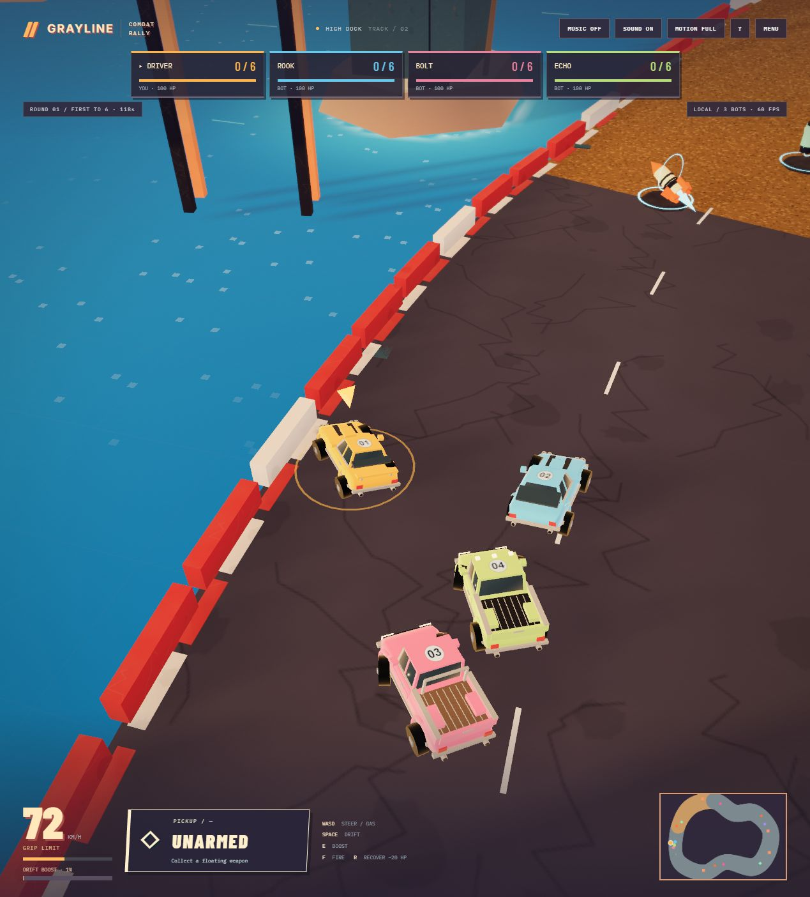

# Vehicle, sound and boost detail pass — 11 October 2026

Published as Sites version 25 at https://grayline-rally.adam489451.chatgpt.site/game/.

## Delivered in separate commits

1. Driving feedback: layered exhaust, intake, low engine rumble, tyre squeal/scrub, gravel and wind; peripheral speed streaks.
2. Vehicle and resort detail: two classic muscle coupes and two open-bed pickups. Chamfered bodywork, tapered glass, chrome trim, grilles, round headlights, mirrors, door handles, hood scoops/stripes, tail lamps, exhaust tips and numbered roofs. Pickups have bed floors, ribs, wheel tubs and different cab equipment. Existing facades gain awnings, window trim, downpipes, rooftop ventilation and foundation ladders.
3. Explicitly requested gameplay addition: six seconds of powered drifting earns a full reserve. E, gamepad LB or mobile BOOST consumes it for the existing 2.4-second boost. Charge persists between corners/recovery and resets each round. Stationary wheelspin, oil and active boost cannot charge it. A fresh press is required. Existing F/RB weapon pickups remain unchanged.

The sound is an original procedural V8 approximation, not a recording of a real engine. No external assets or dependencies were added. V12 and sampled engine recordings were not included; the V8 character suits the chosen vehicles.

## Engine and ownership

Three.js r160 renders the game; native Web Audio provides sound. Vinext/Vite builds the Cloudflare application shell. The existing personal chase camera, vehicle dynamics, collisions, track layouts, weapons and round rules are retained. Vehicle shells preserve the chassis, wheel, suspension and weapon animation handles. Static shell details are merged by material; environment details use four instanced draws.

- `public/game/driving-audio.js`: sound layers and audio-only virtual RPM/gears.
- `public/game/vehicle-detail.js`, `environment-detail.js`: visual geometry.
- `public/game/art-config.js`: shared appearance palette and speed VFX settings.
- `public/game/speed-vfx.js`, `art-post.js`, `art-style.js`: bounded, smoothed peripheral streaks; reduced motion disables them and the HUD stays outside post-processing.
- `public/game/boost.js`, `boost-hud.js`: reserve rules and accessible meter.
- `app.js`, `touch.js`, `index.html`, `style.css`: audio/input/HUD integration.
- `sim.js`, `app/api/room/route.ts`: authoritative boost, replay and network input integration.
- `scripts/check-art-scope.mjs`, `boost-scope.json`: exact baseline comparison after removing the reviewed appearance/audio/boost hooks. No unrelated gameplay changes are permitted.

## Validation and limits

- 87 automated tests pass, including charge eligibility, no feedback loop, fresh-press activation, authoritative replay, round reset, existing handling/camera rules, and room relay boost input.
- Development and publishing builds pass. The pre-existing Vinext static route-classification notice remains; no new build warnings were introduced.
- Public four-seat relay lifecycle test passes against version 25, including authorization, stale input clearing, boost input and reconnect; its QA room was closed afterward.
- Normal keyboard driving, drifting, collisions, recovery, elimination and subsequent rounds were exercised. Meter charging was observed up to 86%, and its reset in the following round was checked. No actor transforms, forced movement, accelerated time or substitute camera were used. The existing help pause was used between some input checks.
- Full-charge E activation was verified in automated simulation/replay tests, but not completed in a natural live race. Physical gamepad/phone controls and subjective speaker/headphone listening remain unverified. The mobile UI was visually checked at 390 × 844 and its temporary viewport was reset.
- No browser warnings/errors were observed in the local or public build.
- Warm local 300-frame samples at 1269 × 1404, DPR 1: 60.00–60.01 FPS, median 16.7 ms, p95 17.5 ms, median render CPU 2.6–2.7 ms. The previous art audit recorded about 56.6 FPS; these are observational samples, not a controlled hardware benchmark. An initial shader warm-up briefly reduced the HUD frame-rate reading before it settled. Public gameplay displayed 60 FPS.
- `public/game/audio-diagnostic.html` is explicitly a synthetic diagnostic, not a gameplay demo. It renders the production Web Audio graph offline: engine RMS 0.05284 / peak 0.20557, drifting RMS 0.06702 / peak 0.26717, muted RMS and peak 0. Peaks remain below clipping (1.0).

Cloudflare TURN code exists, but live `TURN_KEY_ID` and `TURN_KEY_API_TOKEN` configuration is absent. TURN has not been enabled. Direct connections and the existing server relay fallback remain available.

## Tune these first

1. `DRIVE_SOUND.exhaust`: exhaust gain; lower if it masks the supplied music.
2. `DRIVE_SOUND.tyres`: skid tone gain, mixed with scrub noise.
3. `ART.speedVfx.strength`: peripheral streak visibility.
4. `ART.vehicleDetail`: chrome, glass, stripe, wood and light palette.
5. `BOOST.chargeSeconds`: required powered-drift time, in seconds; currently 6.

